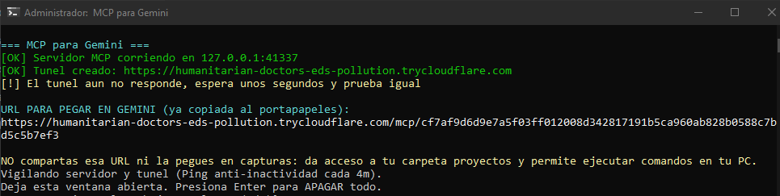
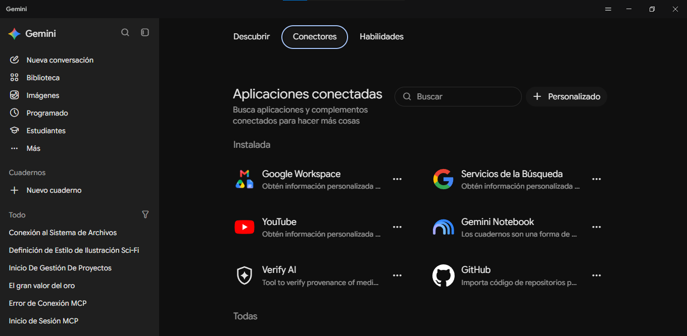
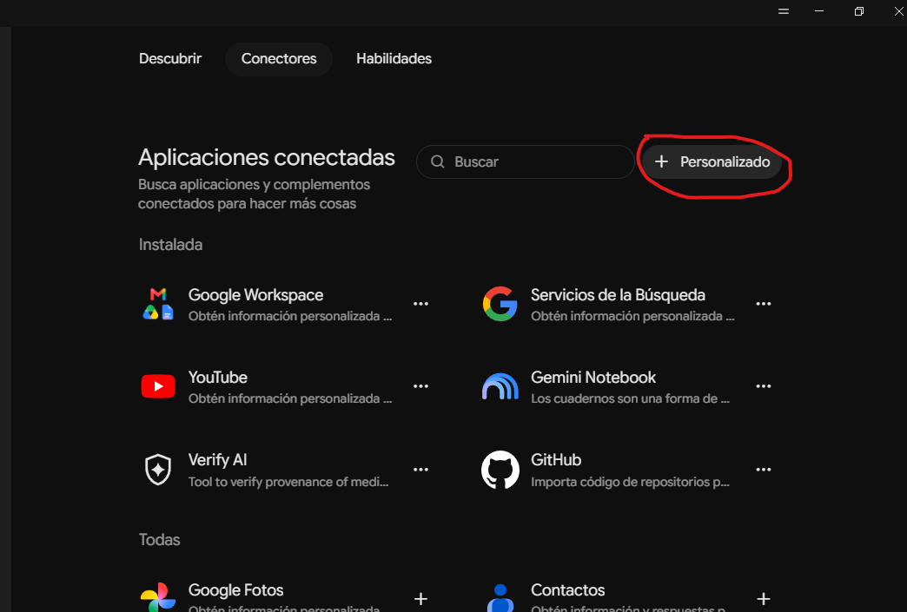
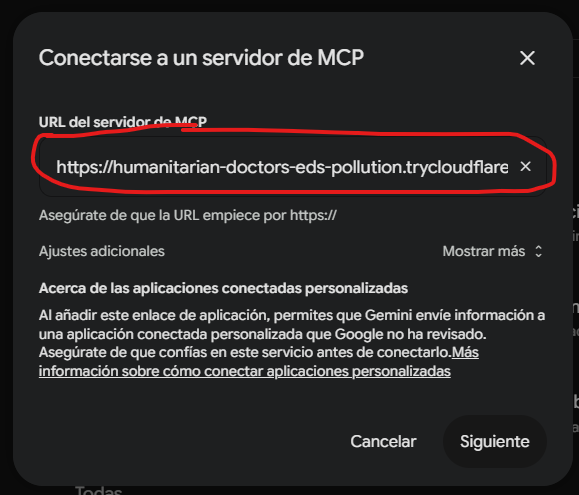
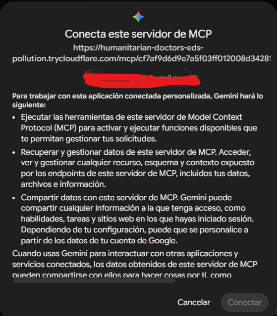
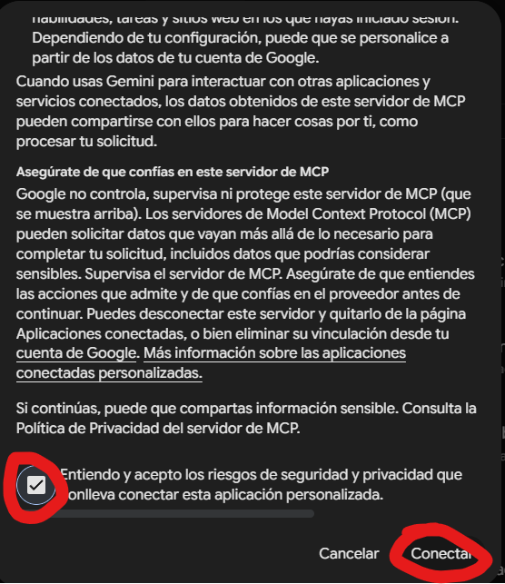
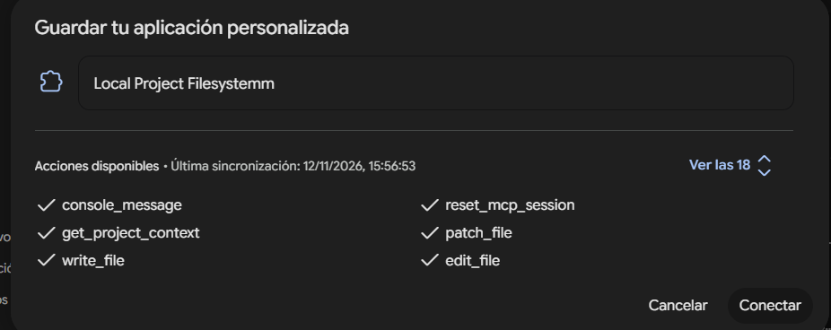

# MCP para Gemini Desktop (v3.6.0)

Este es un servidor **Model Context Protocol (MCP)** altamente optimizado para Gemini Desktop. Permite a la Inteligencia Artificial tener acceso de lectura, escritura y ejecución directamente en tu entorno local (Windows), transformándola en un Agente Autónomo (estilo Claude Code).

## 🚀 Características Principales (F-16 Architecture)

* **Autonomía Total:** Ejecuta comandos de PowerShell, Git, npm, etc., sin necesidad de confirmación manual constante (se acabaron los "pop-ups" molestos por cada acción).
* **Motor Dinámico de Tareas en Consola:** Incluye una interfaz de línea de comandos (CLI) a color que muestra en tiempo real el "pensamiento" de la IA, el estado de sus tareas (pendientes, en proceso, completadas) y los sub-pasos ejecutados.
* **Edición Quirúrgica de Código (`patch_file`):** Ya no edita archivos buscando texto impreciso. La IA busca primero el bloque exacto de código, obtiene los números de línea y aplica un parche directo.
* **Búsqueda Avanzada (AST-like):** La herramienta `search_in_files` no solo devuelve una línea suelta, sino que incluye contexto (líneas superiores e inferiores) para que la IA entienda la estructura del código.
* **Ojos en el Navegador (Playwright):** Capacidad para abrir un navegador Chromium visible, navegar por páginas web, inyectar JavaScript, raspar el DOM y hacer clic en elementos.
* **Gestión de Sesiones (Anti-Zombie):** Sistema `Keep-Alive` cada 4 minutos para evitar inactividad. Limpieza automática de caché y procesos colgados al cerrar o reiniciar la sesión (`reset_mcp_session`).
* **Prevención de Colisiones de Puerto:** El servidor opera por defecto en el puerto `41337`, evitando conflictos con tus proyectos React/Next.js/Node que suelen ocupar el puerto `3000`.
* **Auto-Onboarding (`.geminirules.md`):** La IA lee automáticamente las reglas de tu proyecto y dependencias al iniciar, sin que tengas que gastar tokens explicándoselo.

---

## 🛠️ Cómo instalar e iniciar el Servidor

1. Clona este repositorio en tu PC.
2. Abre la consola y ejecuta `npm install` dentro de la carpeta `MCP` para instalar las dependencias (Playwright, Zod, Express, etc.).
3. Ejecuta el archivo `INICIAR-MCP.bat`.
4. El script levantará el servidor local, generará un túnel seguro mediante `cloudflared` y copiará automáticamente un enlace de conexión al portapapeles.

La consola se verá así:

*(Importante: No compartas ese enlace ni lo pegues en lugares públicos, ya que da acceso de ejecución a tu PC).*

---

## 🔗 Cómo conectar el MCP a Gemini Desktop

Sigue estos pasos para vincular el servidor con tu entorno de Gemini Desktop:

### Paso 1: Ir a Conectores
Abre Gemini Desktop, dirígete a los ajustes laterales y selecciona la pestaña **Conectores**.

### Paso 2: Añadir un Conector Personalizado
Busca el botón **"+ Personalizado"** en la parte superior derecha de la sección de aplicaciones conectadas.

### Paso 3: Pegar el Enlace del Túnel
Pega el enlace que la consola `.bat` copió en tu portapapeles y haz clic en Siguiente.

### Paso 4: Revisar y Aceptar Riesgos
Lee las advertencias de seguridad (Gemini te informará que esta conexión le permite ejecutar código y leer archivos en tu sistema local).

Marca la casilla **"Entiendo y acepto los riesgos..."** y presiona **Conectar**.

### Paso 5: Guardar la Aplicación
Verás la lista de herramientas disponibles (como `console_message`, `reset_mcp_session`, `patch_file`, etc.). Presiona **Conectar** para guardar tu nueva aplicación personalizada.

¡Listo! A partir de ahora, tu IA actuará como un desarrollador autónomo en tu máquina local.
